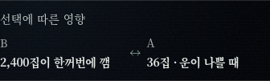
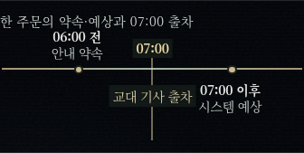
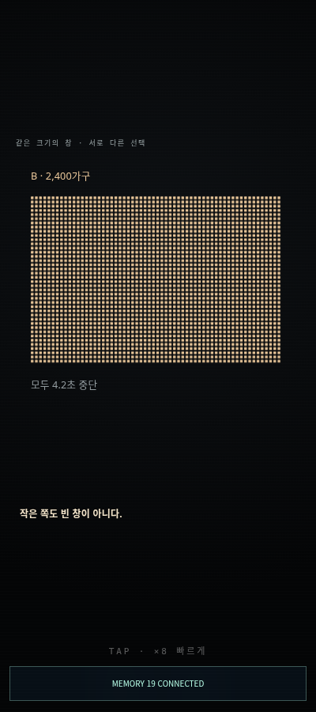

# 제19화 실제 삽화·그래픽 평가

> 후속 삽화 확인(2026-10-24): 현행 door·wrist-detail·windows 원본을 메인과 독립 reviewer가 다시 보았다. 세 컷은 오른손목의 멍·검은 띠가 이어지며, windows에도 띠가 선명하다. 아래 당시의 좌우 의심·띠 누락 평가는 철회한다. 원화는 유지했다. 본문 밖 화말 수치는 이번에 제거했다. 최종 수정·PC/모바일 비교는 [후속 기록](../hyona-illustration-fixes-20261024/README.md)을 따른다. 아래는 수정 전 평가 이력이다.

검토 기준은 main3884773의19화와 이번 수정본이다. 실제 웹 연결을 코드로 찾고 원화4개를 모두 직접 열었다. Chromium400×900에서 본문에 삽입되는 네 원화와 두 정보 그래픽을 확인했다. VN 컷신이나 기획 문서만 있는 그림을 웹소설 삽화로 세지 않았다. 자산·배치·캡션은 수정하지 않았다.

| 대상 | 실제 확인 | 장면 적합성과 몰입 | 남길 판단 |
| --- | --- | --- | --- |
| `ep19-door-web.webp` | 원본 및 모바일 삽입 | 문턱 밖 서인·붉은 경계·안쪽 인물로 권한 차이가 바로 보인다. 뒤의 윤세라가 앉아 있는 점도 본문과 맞는다. 문 앞 강연우의 정면 자세는 서인을 막는 인물처럼 읽힐 여지가 있다. | 구도는 유효. 강연우가 동행자라는 문맥과 맞는지 후속 원화 검토 시 주의. |
| `ep19-wrist-detail-web.webp` | 원본 및 모바일 삽입 | 멍과 띠가 지난 방문의 위험을 이어 준다. 손등/엄지의 방향은 왼손처럼 읽힐 여지가 있어 본문의 오른손목 설정과 좌우 재검토가 필요하다. | 좌우 확인 필요. 문턱 그림 직후 같은 문단에서 연속으로 나오는 두 세로 컷이 각각약443px라, 첫 심사 대사로 들어가기 전 스크롤을 오래 차지한다. |
| `ep19-home-life-web.webp` | 원본 및 모바일 삽입 | 아기·부엌·알람으로 사람들을 깨우는 생활 비용이 보인다. 예측임을 밝힌 캡션이 있어 현재 동네에서 실제 벌어진 일로 읽힐 위험을 낮춘다. 이번 알람 문장 변경과도 어울린다. | 유지할 가치가 높다. 서인의 선택이 누구에게 닿는지 보여 준다. |
| `ep19-windows-web.webp` | 원본 및 모바일 삽입 | 두 구역의 불빛 차이를 서인이 보는 장면은 선택 이유를 돕는다. 다만 멍이 보이는 앞쪽 손목에 앞 컷의 띠가 보이지 않아 같은 면담 장면의 연속성이 흔들린다. | 손목 띠 연속성 수정 필요. 정확한36은 원화만 세어 판독할 수 없어 본문·비교표가 함께 필요하다. |
| A/B 정보 그래픽 | 실제 렌더링과 캡처 |2,400집과36집·가능성 조건을 짧게 대조한다. 같은 내용의 원화 바로 다음이라 수치 파악은 쉽지만 독서 흐름상 정보가 겹친다. | 정보는 적절. 원화·표의 연속 밀도를 후속 연출 편집에서 검토할 만하다. |
| 배송 시간 정보 그래픽 | 실제 렌더링과 캡처 |06:00전 안내 약속,07:00출차,07:00이후 시스템 예상의 순서가 보인다. 수정본의 다음 날 새벽이라는 날짜 기준과 연결된다.06:30도시락 수령·조리 손해는 본문이 전달한다. | 현재 시간 차이를 이해하는 데 유효하다. |
| 화말 `node31b` SVG | 소스 및 정상 모션의 직접 미리보기 | B2,400/A36의 비교 뒤 본문에 없는4.2초 중단·과부하3.8%·최대18분을 표시한다. 실제 캡처에서도4.2초가 보였고 나머지 값은 DOM/소스에서 확인했다. 독자는 이 수치도 소설이 확정한 정보로 받아들일 수 있다. | **현재 본문과 정합하지 않아 수정 필요.** 후속 연출 수정에서는 본문에서 이미 읽은 정보로 표시 범위를 맞춰야 한다. 이번 작업에서 본문에 옛 수치를 다시 넣거나 SVG를 바꾸지 않았다. |

화말 SVG는 큰 점 행렬과 작은 수치 중심이라, 앞서 본 아기·부엌·알람의 생활 장면에 비해 누가 잠을 잃는지 연결하는 힘이 약하다. 본문 중간의 원화와 비교표에서 이미 읽은 초반 시험을 마지막에 다시 요약해, 참여자4가 방금 주문을 보고 갔다는 끝의 긴장을 끊을 수도 있다. 후속 연출 편집에서는 노출 위치와 반복 분량도 함께 검토할 필요가 있다.

원화 네 장은 이 묶음 안에서 선화·채색의 큰 이질감은 적다. 전체 인물 원화나 티저와의 일대일 화풍 대조까지 완료한 평가는 아니다. 피부·손목·인물 배치의 정합성 문제는 그림의 화질과 별도로 남긴다.

## 실제 화면 근거

아래 캡처는 현재 소스의 실제 렌더링이다. 비교표/배송표는 모션 감소 설정의 정지 화면, 화말은 정상 모션 설정에서 기존 미리보기를 호출한 초기 화면이다. 자연 스크롤 발동·전체 시간 연출의 검증은 포함하지 않는다.

원본 확인 경로는 `assets/sequence19-22/ep19-{door,wrist-detail,home-life,windows}-web.webp`다. `reader-sequence19-22.js`의 정확한 원문 앵커 네 곳은 수정 후에도 모두 연결된다.
