# 사건 원화 미리보기 · 미완료 초안

원화 검수 PASS와 게임 연결·플레이 검증은 별개다. CHANGES는 교정 필요, PENDING은 현재 버전의 독립 검수 대기다. 보류5편은 원화만 준비하며 게임에는 연결하지 않는다.

| 화 | 장면 | 최신 원화 검수 / 게임 연결 | 미리보기 |
| --- | --- | --- | --- |
| 4-1 | 서인이 메모지를 한 장 뜯었다. 회의실 비품함에 굴러다니던 종이였다. 화면에 쓰면 모델이 받아 적는다. 종이는 아무도 안 받아 적는다. | PASS / 미연결 | 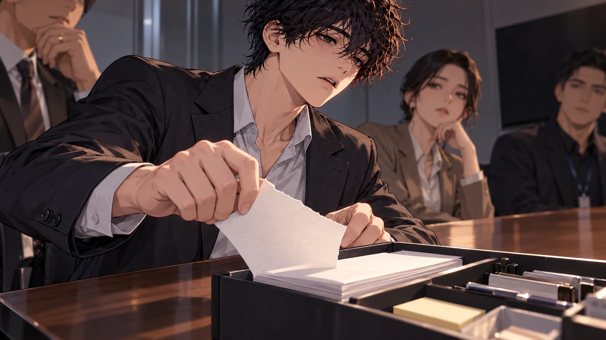 |
| 6-1 | 딸은 ‘매일 엽니다’ 위에 그 종이를 대고, 네 귀퉁이에 테이프를 꼼꼼히 붙였다. | CHANGES / 미연결 | 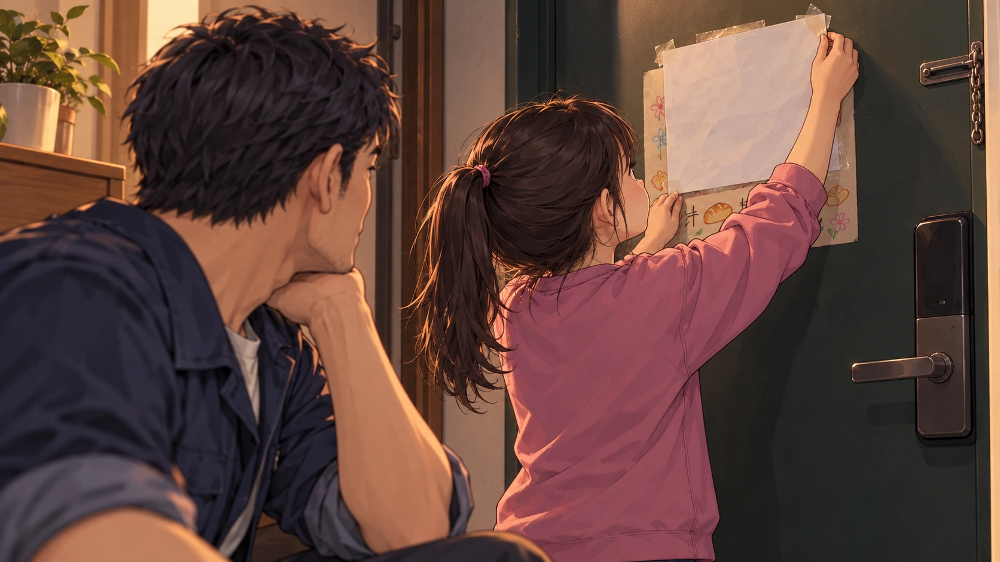 |
| 7-2 | 도윤이 가방을 열었다. 바닥에 고인 물을 먹은 종이가 한 덩어리로 불어 있었다. | CHANGES / 미연결 | 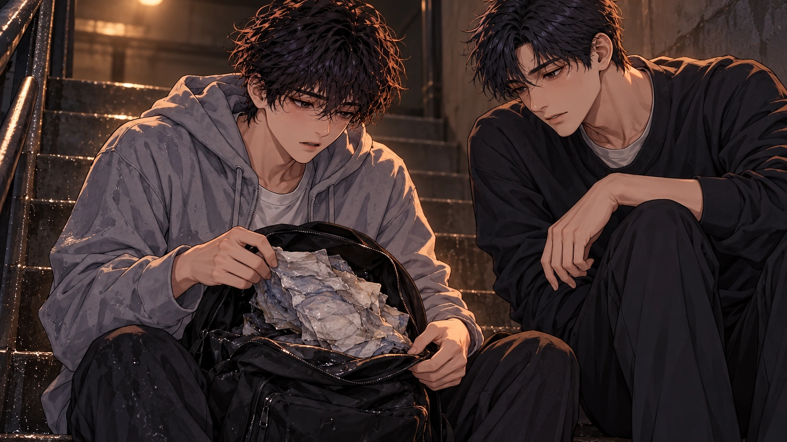 |
| 8-1 | 긴 탁자에 의자가 열셋이었다. 표를 가진 열한 명이 먼저 앉아 있었다. 종이 한 장 없이 각자의 홀로그램 지표만 떠 있었다. 서인은 끝에서 두 번째, 명패에 '의결권 없음'이 찍힌 자리에 앉았다. | PASS / 미연결 | 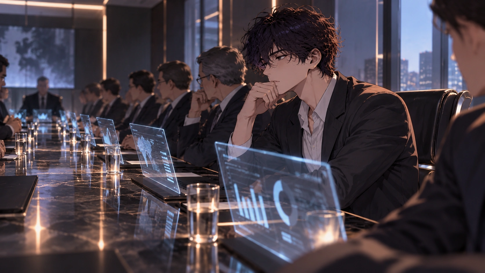 |
| 8-3 | 도윤은 손을 뻗었다가 멈췄다. 그 손을 무릎으로 거두고 등받이에 몸을 기댔다. | CHANGES / 미연결 | 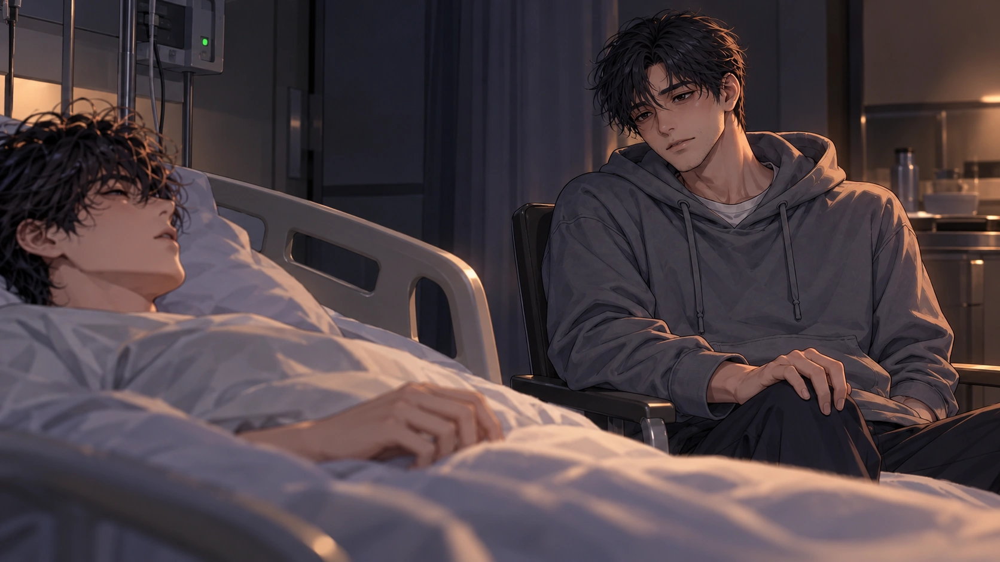 |
| 9-1 | 서인은 이름 끝에 묻은 흙을 털려던 손을 거뒀다. | CHANGES / 미연결 |  |
| 12-1 | 휴대폰을 엎었다. 글러브박스에서 손바닥만 한 수첩을 꺼냈다. 볼펜으로 한 줄씩 적었다. | PASS / 미연결 | 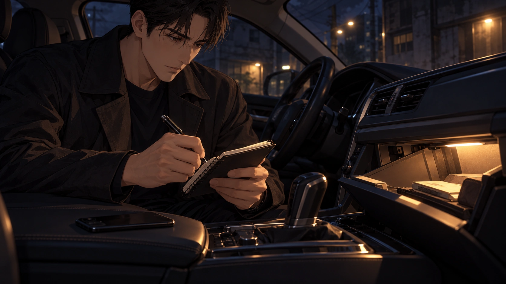 |
| 13-1 | 지우는 손을 내려다봤다. 진흙이 손목까지 올라와 있었다. | CHANGES / 미연결 |  |
| 13-2 | 태석은 수첩으로 눈을 내렸다. 볼펜 끝으로 종이를 눌렀다. 셋을 셌다. 하나에 발소리가 가로등 쪽으로 왔다. 둘에 가로등 아래를 지났다. 셋에 멀어졌다. 종이에 볼펜 자국이 깊게 패었다. | PASS / 미연결 |  |
| 15-1 | 도윤은 주머니에서 냅킨을 한 장 꺼냈다. | PASS / 미연결 |  |
| 16-1 | 더 확인할 수 있는 문서가 세 개 남았다. 서인은 그 목록을 닫았다. 배차 담당에게 남은 확인을 넘기고 회사 업무 화면에서 접속을 끊었다. | CHANGES / 미연결 |  |
| 24-1 | 서인이 자기 단말을 꺼냈다. 회의실 결제 코드를 찍었다. | PASS / 미연결 | 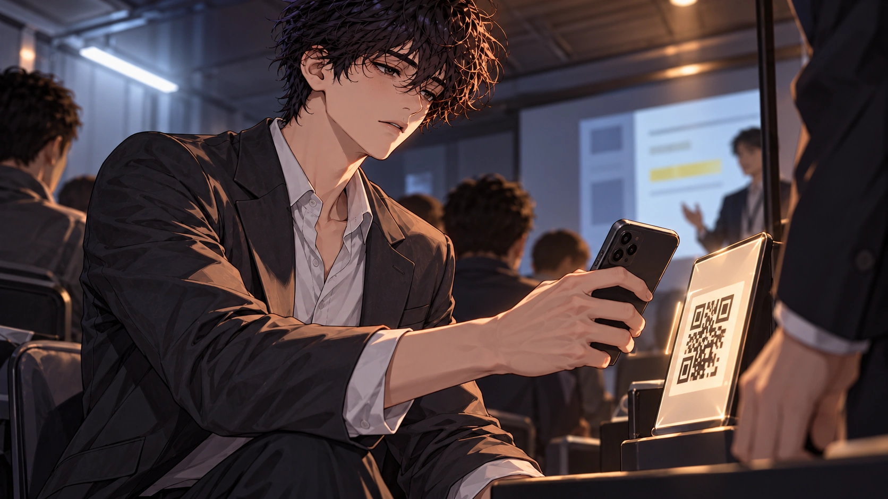 |
| 25-1 | 어머니는 손을 닦고 약관을 처음부터 읽었다. | PASS / 미연결 | 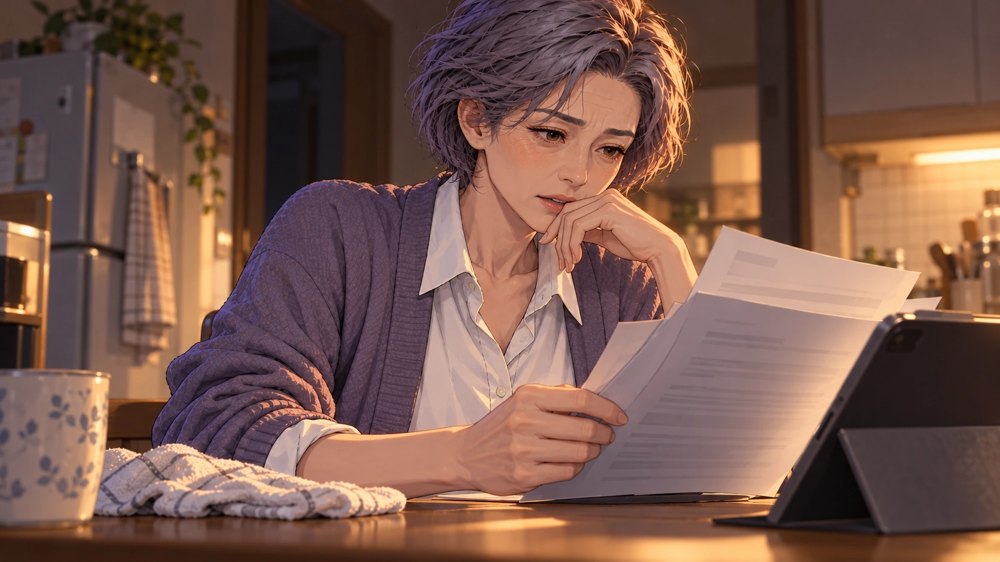 |
| 30-1 | 도윤이 손을 쥐었다. 손가락 사이로 피가 계속 나왔다. 그런데 도윤은 손보다 먼저 현관문을 봤다. 종이가 반은 붙어 있었다. | PASS / 미연결 | 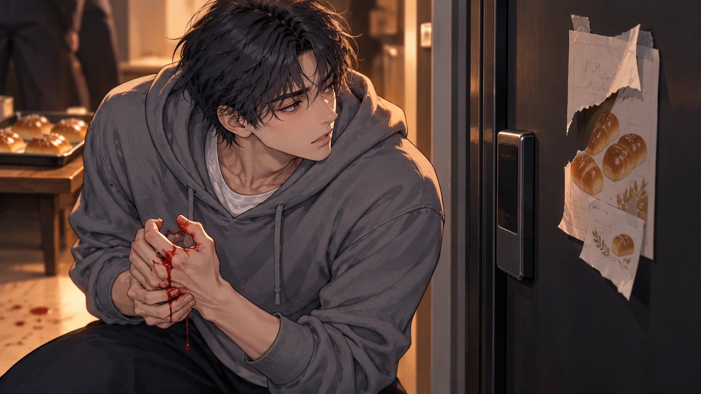 |
| 30-2 | 하경이 벽의 종이 하나를 떼었다가 다시 붙였다. | PASS / 미연결 | 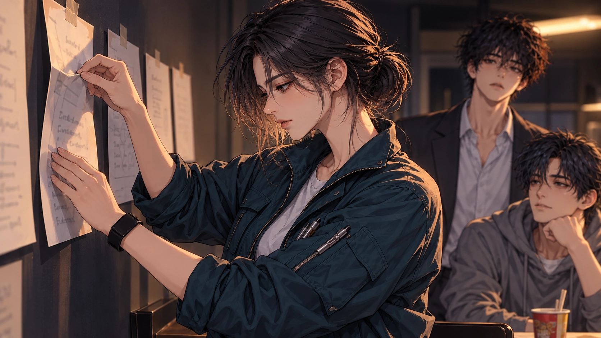 |
| 31 | 화면 속 다은이는 교정기를 낀 입을 꾹 다물고 있었다. | PASS / 미연결 |  |
| 32 | 남자는 접수서의 계정명을 확인하고서야 단말을 돌려줬다. | PASS / 연결됨 | 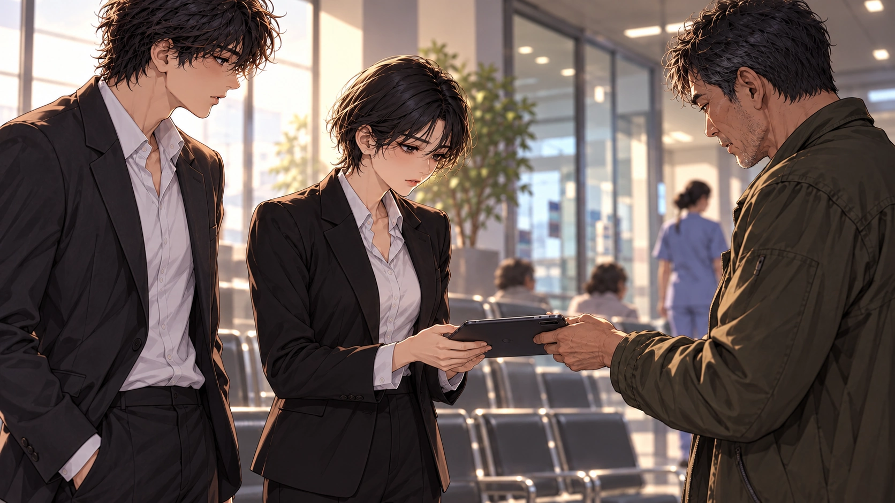 |
| 33 | 다은이 한참 화면을 봤다. | PASS / 미연결 | 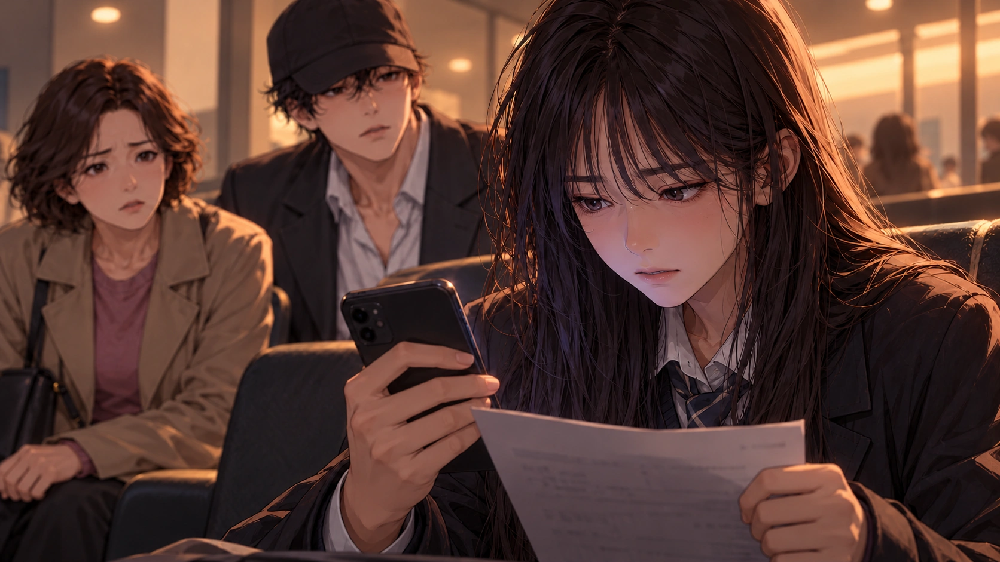 |
| 34 | 여자가 자기 이름표를 만졌다. | PASS / 미연결 |  |
| 35 | 손끝이 떨렸다. | PASS / 연결됨 | 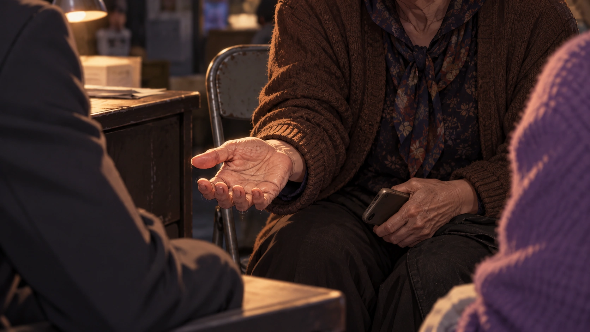 |
| 36 | 윤세라는 그 화면을 봤지만 아무것도 묻지 않았다. | PASS / 연결됨 |  |
| 37 | 서인은 손가락으로 그 줄을 짚었다. | PASS / 연결됨 | 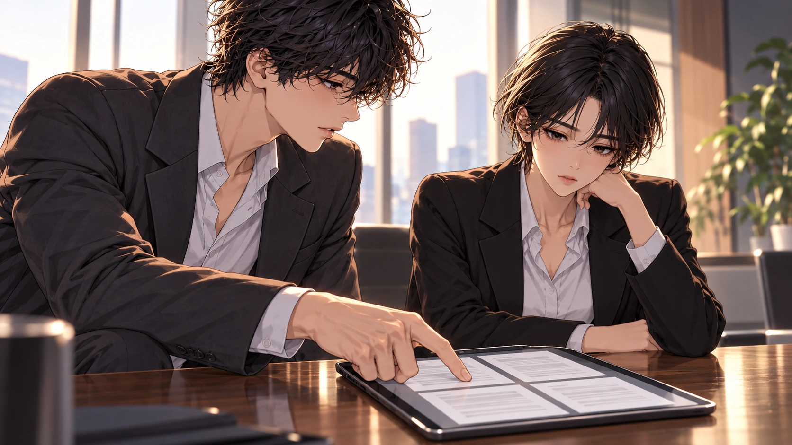 |
| 38 | 서인은 자기도 모르게 숨을 내쉬었다. | PASS / 연결됨 | 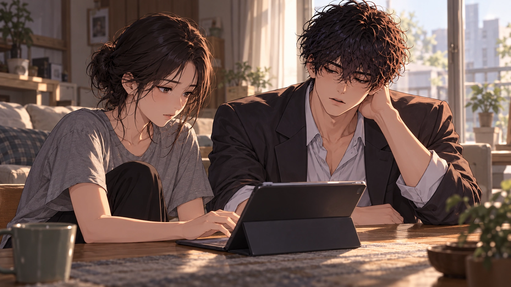 |
| 39 | “보름 가까이 기다렸어. 들어간 사람들이 첫날은 일찍 누우래.” | PASS / 연결됨 |  |
| 40 | 패가 담요 끝을 넘어가 장판 위로 떨어졌다. | PASS / 연결됨 | 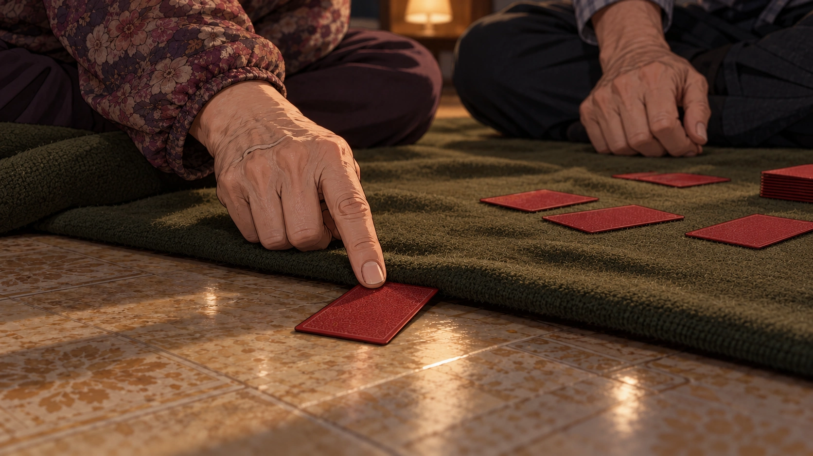 |
| 41 | 서인은 사진을 닫지 않고 진행률 창 옆으로 끌어다 놓았다. | PASS / 미연결 | 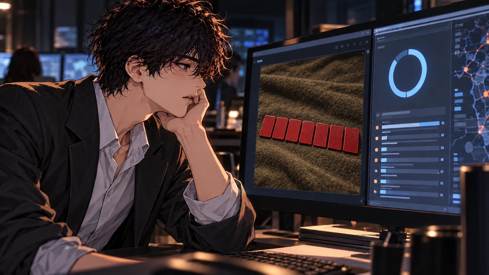 |
| 42 | 보안팀 직원 둘이 들어왔다. 한 사람이 서인의 관자놀이에 얇은 감지 패치를 붙였다. 차가웠다. 다른 사람이 서인의 단말과 손목 밴드를 받아 갔다. | PASS / 미연결 |  |
| 43 | 서인은 캡처를 확대했다. | PASS / 미연결 |  |
| 44 | 강연우는 반대하지 않았다. 대신 서랍에서 얇은 보안 단말을 꺼냈다. | PASS / 미연결 | 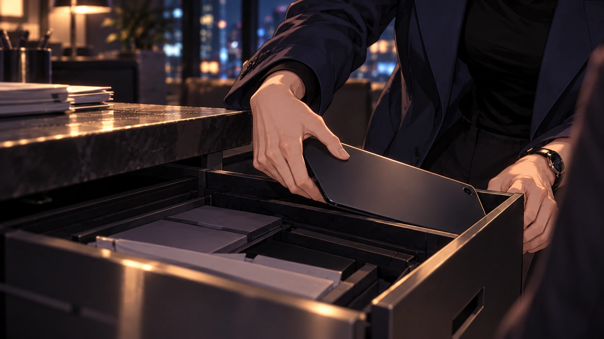 |
| 45 | 도윤은 휴대폰을 서인 무릎에 내려놓고 자기 셔츠 자락으로 서인의 이마를 닦았다. | PENDING / 미연결 | 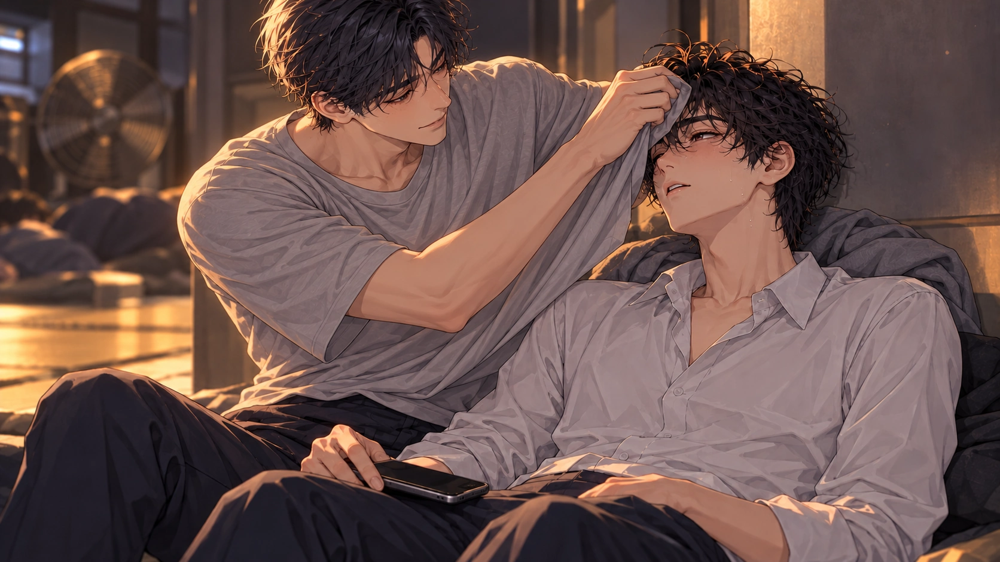 |
| 46 | 빵이 들어간 뒤에 서인은 접은 종이를 꺼냈다. 화면 대신 손으로 쓴 것이었다. | PASS / 미연결 |  |
| 47 | 윤 여사는 볼펜을 탁 내려놓고 매트로 갔다. | PASS / 미연결 | 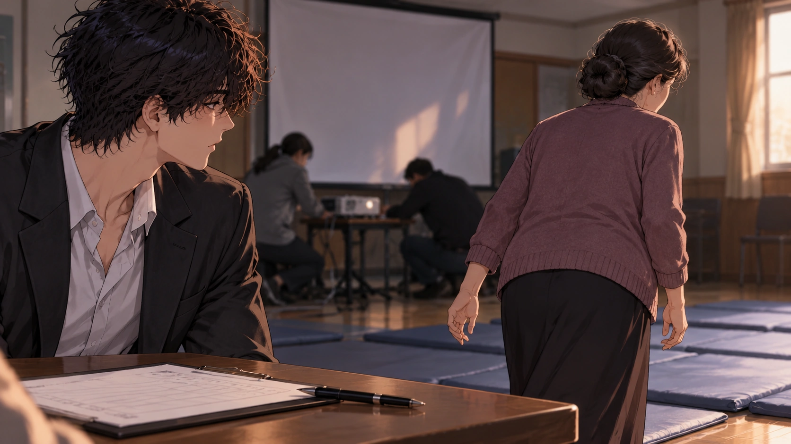 |
| 48 | 어머니가 깎던 사과를 접시에 내려놓았다. | PASS / 미연결 |  |
| 49 | 회색 점퍼는 자기 단말에서 무언가를 지웠다. 서인이 보니 31구역 주민센터 대관 예약이었다. 다음 주 두 번째 설명회 자리였다. | PASS / 미연결 | 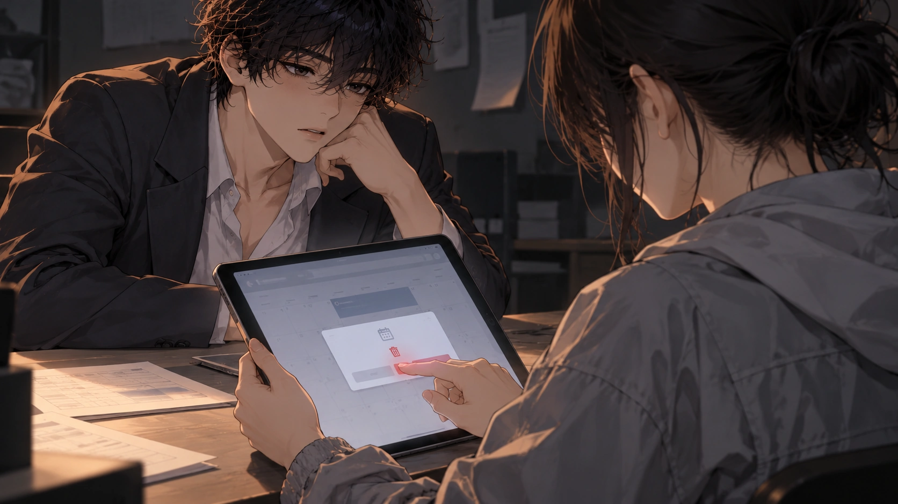 |
| 49-1 | 서인이 봉투를 건넸다. 지우가 봉투 끝을 잡았다. 서인은 놓지 않았다. 놓으려고 했는데 손가락이 안 펴졌다. | CHANGES / 미연결 | 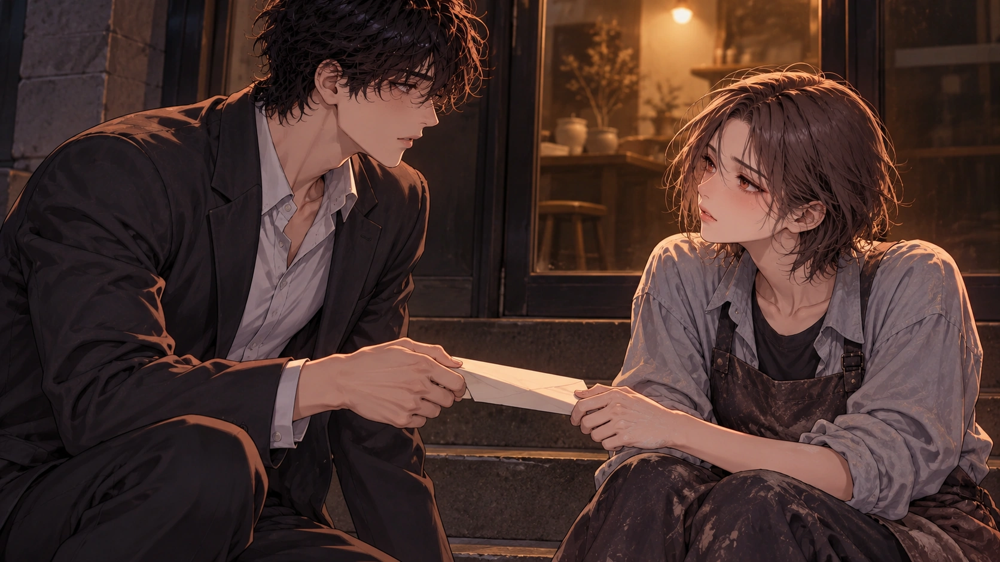 |
| 50 | 도윤은 양동이를 빈 물통 옆에 내려놓다가 서인의 화면을 봤다. | PASS / 미연결 | 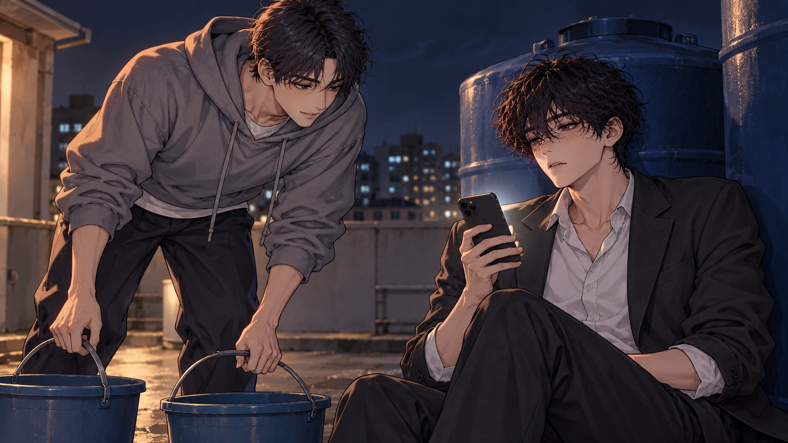 |
| 50-1 | 손님의 볼펜이 종이 위에서 멈췄다. 한참 그대로였다. 쓸 칸이 없었다. | CHANGES / 미연결 | 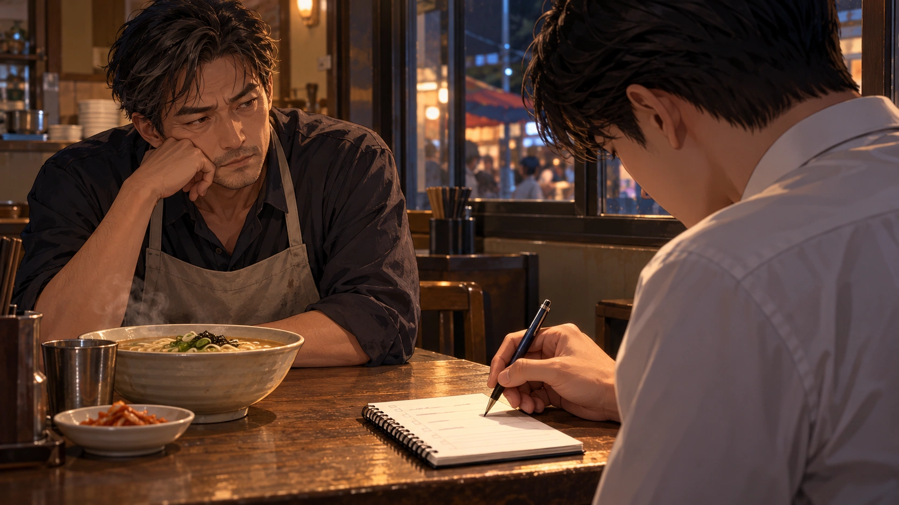 |
| 51 | 어머니는 서명란에 이름을 썼다. 서인은 그 이름을 보지 않으려고 눈을 내렸다. 화면이 서명을 받아 한 줄을 바꿨다. | PASS / 미연결 | 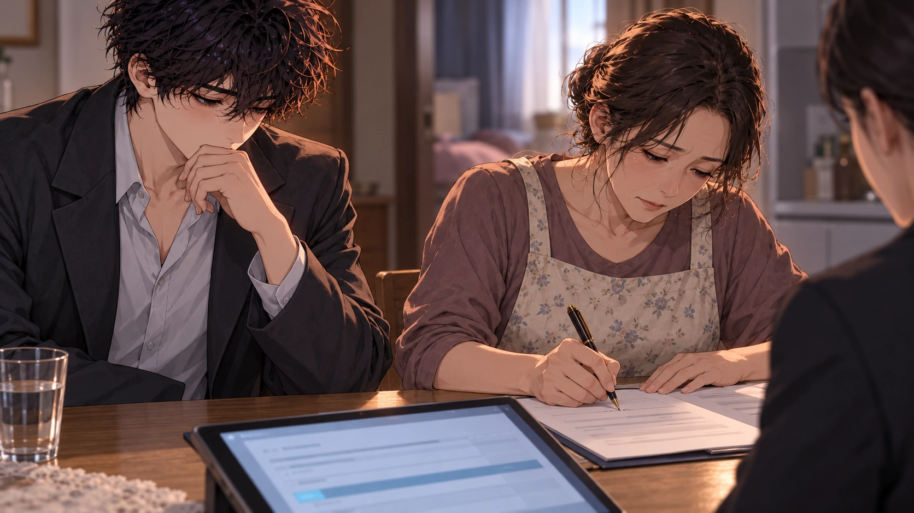 |
| 52 | 서인은 서식을 끌어당겼다. 볼펜을 꺼냈다. 요청자 칸 위에서 볼펜이 멈췄다. | PASS / 미연결 | 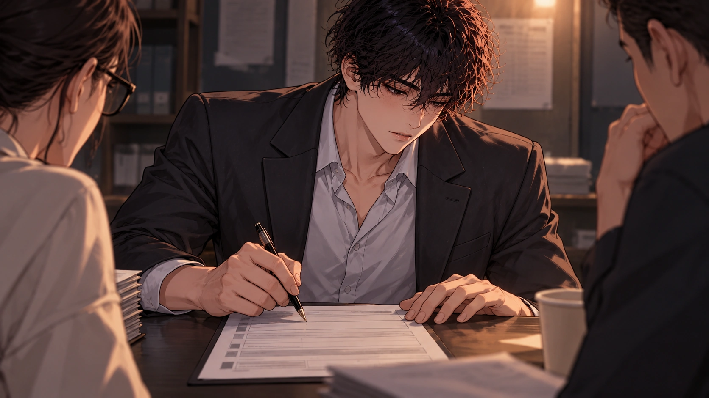 |
| 53 | 아들은 어머니를 봤다. 노인은 앞을 보고 있었다. 아들이 서류철을 무릎 위에 올려놓았다. 그러고는 휴대폰을 꺼내 알림 시간을 낮으로 바꿔 보았다. 오전 열 시부터 오후 두 시. 그가 자는 시간이었다. 그는 설정을 다시 '항상'으로 돌려놓았다. | PASS / 미연결 | 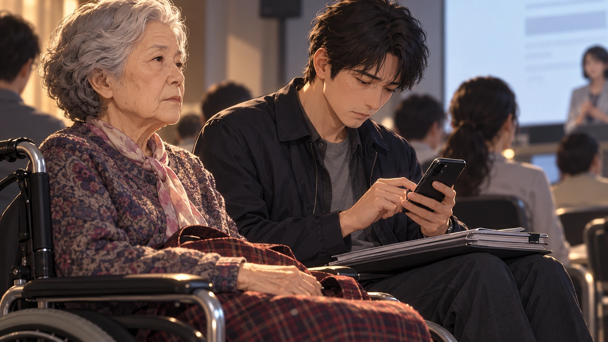 |
| 54 | 민석은 계산기를 열었다. 분류로 옮긴 뒤 한 주에 빠지는 시급 차액을 넣었다. 거기서 풀 정산 21을 뺐다. 모자라는 숫자가 작게 남았다. 21을 지웠다. 숫자가 두 배 넘게 커졌다. 장부실 생활비는 이제 열 주 남아 있었다. | PASS / 미연결 |  |
| 55 | 서인은 알림을 닫고 문서를 열었다. 옥상에서 쓴 뒤로 한 번도 열지 않은 문서였다. | PENDING / 미연결 |  |
| 56 | 1호 때는 없던 칸이었다. 하경이 종이와 펜을 서인 앞으로 밀었다. | PASS / 미연결 | 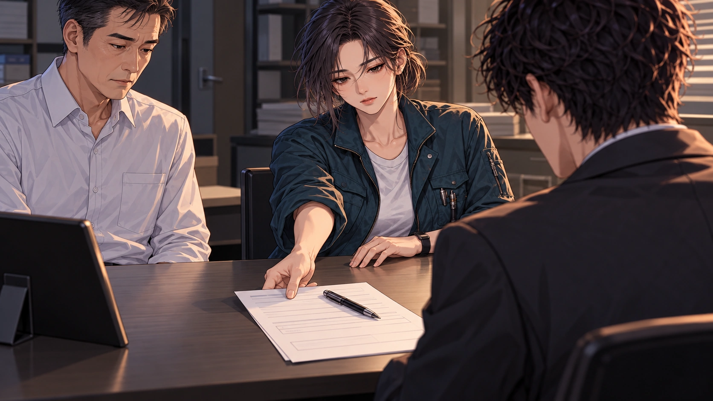 |
| 57 | 장부실 벽에 코르크판이 하나 새로 걸렸다. 주민센터 설명회 때 쓰고 돌려받은 판이었다. 하경이 매직으로 가운데에 세로줄을 하나 그었다. 왼쪽 위에 '재연결', 오른쪽 위에 '해제 유지'. | PASS / 미연결 | 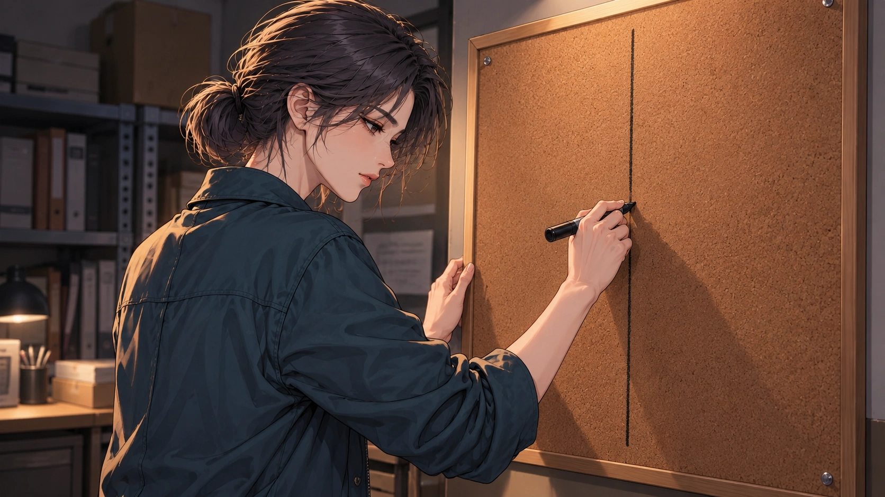 |
| 58 | 서인은 휴대폰에서 서식 사본을 열었다. 맨 뒤, 세 번째 장. 일주일 전 장부실에서 명진 앞에 놓고 손가락으로 짚었던 줄이었다. | PENDING / 미연결 | 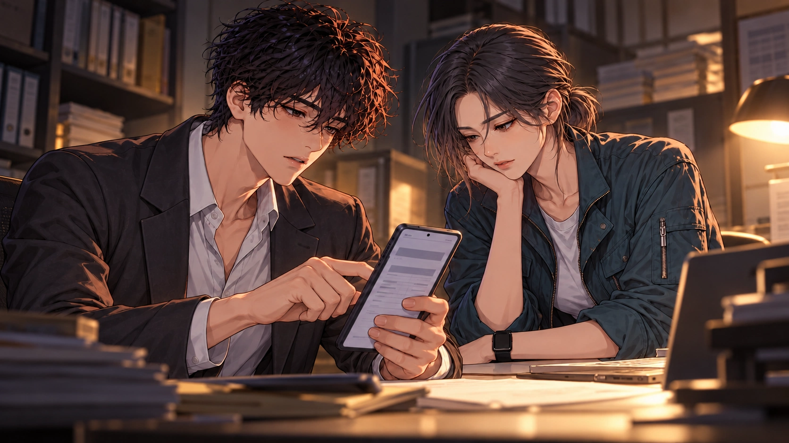 |
| 59 | 아이는 노란색으로 파란색 위에 동그라미를 그렸다. 해였다. 바다 위의 해. 오른손이 세게 지나갈 때마다 종이가 서인의 손가락 밑에서 조금 당겨졌다. 서인은 손가락에 힘을 줬다. | PASS / 미연결 | 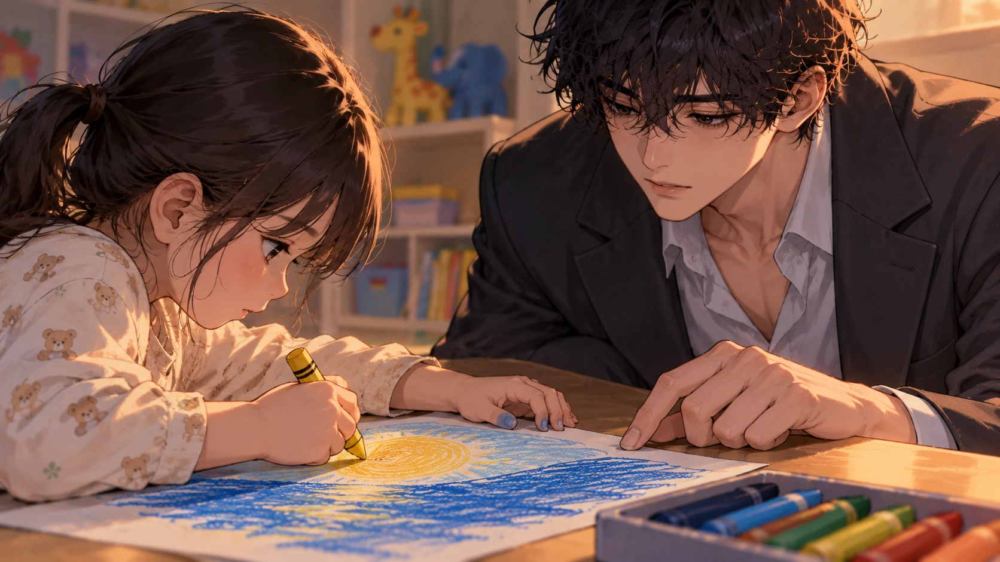 |
| 60 | 계단에서 발소리가 났다. 하경이 아니었다. 목요일 밤에 생각해 보겠다며 나갔던, 안경 쓴 남자였다. 그는 서인에게 고개만 숙이고 코르크판의 세 장을 위에서 아래로 읽었다. 그러고는 07 풀 종이 앞에 섰다. 펜을 집었다. 이번에는 내려놓지 않았다. | PENDING / 미연결 | 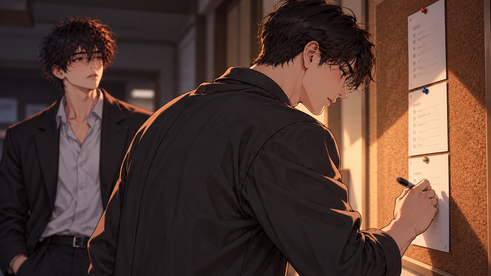 |
| 61 | 오정택이 서류철에서 종이 한 장을 빼 창턱의 캔 옆에 놓았다. | PASS / 미연결 | 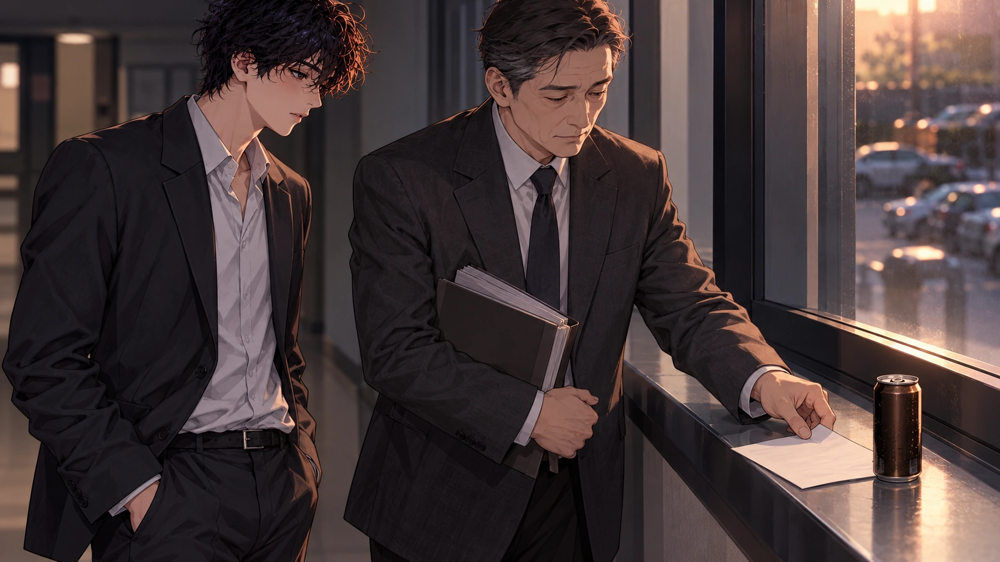 |
| 62 | 현수는 휴대폰을 꺼내 화면을 몇 번 넘기더니 책상 위로 밀어 주었다. 신탁 본인 열람 화면이었다. | PENDING / 미연결 |  |
| 63 | 나래가 공책을 가져와 서인 앞에 펼쳤다. 강 양쪽 둑만 그려져 있고 가운데가 비어 있었다. | PASS / 미연결 | 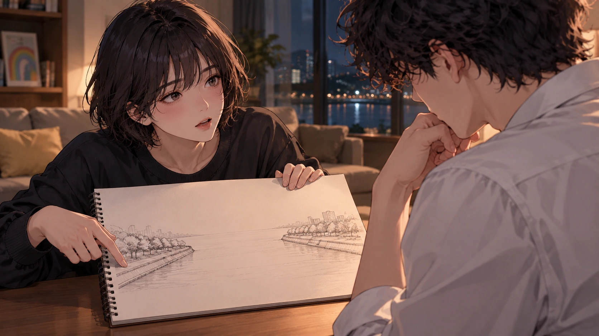 |
| 64 | 오정택은 종이를 서인 쪽으로 돌렸다. 맨 아래 제안자 칸이 비어 있었다. 서인은 펜을 받아 이름을 썼다. 오정택은 종이를 돌려받아 직인을 찍었다. | PASS / 미연결 |  |
| 65 | 오정택은 태블릿을 돌려받았다. 화면을 끄지 않고 기록 맨 아래 줄에 손가락을 대고 있었다. | PASS / 미연결 | 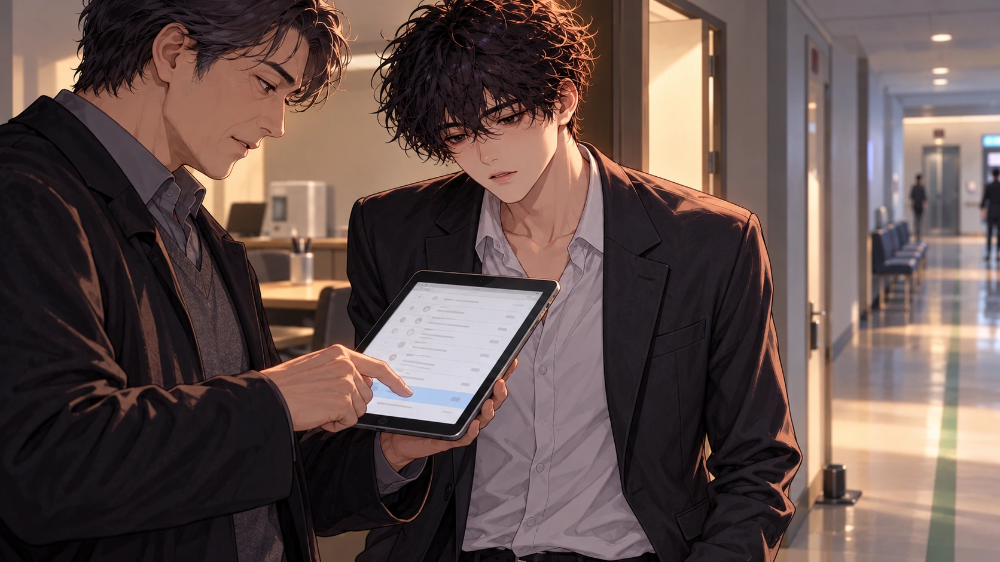 |
| 66 | 어머니가 휴대폰을 식탁에 놓고 서인에게 밀었다. | CHANGES / 미연결 | 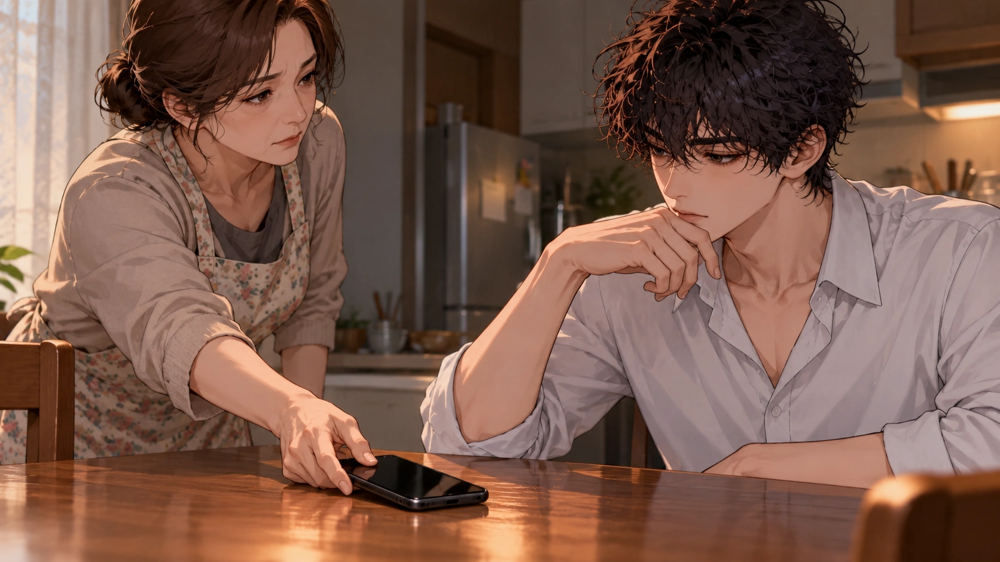 |
| 67 | 밤 10시 반, 서인은 노인정 문에 종이를 하나 더 붙였다. 손글씨 종이와 구청 안내문 사이였다. 작은 종이였다. 서인은 모서리를 손바닥으로 한 번 눌렀다. 어머니가 하던 대로였다. | CHANGES / 미연결 | 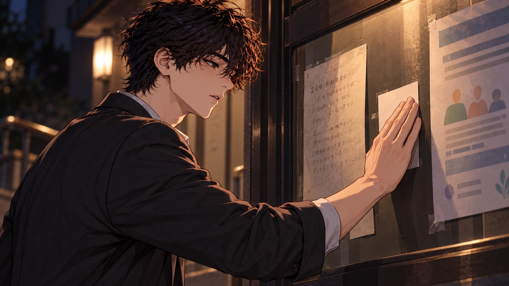 |
| 68 | 순덕 할머니가 휴대폰을 꺼내 화면을 보여 주었다. 오늘 밤 송출 예고였다. 하얀 모래, 파란 물, 발자국 하나 없는 바닷가. | PASS / 미연결 |  |
| 69 | 서인은 담요 옆에 앉아 보고서 초안을 열었다. 판정 칸 하나가 비어 있었다. | CHANGES / 미연결 | 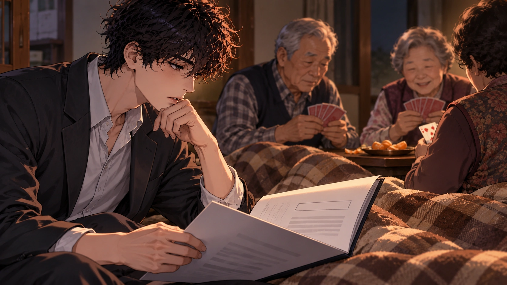 |
| 70 | 저녁 8시 반, 판이 두 번째 돌 때 윤 여사가 휴대폰을 서인 앞에 내밀었다. | PASS / 미연결 |  |
| 71 | 서인은 ‘미정’ 두 글자 위에 손가락을 올렸다가, 지우지 않고 문서를 닫았다. 노인정에 사람을 모아 스물네 시간 동안 모든 조건을 끄는 일은 아직 시작할 수 없었다. | CHANGES / 미연결 |  |
| 72 | 서인은 가방에서 출력해 온 종이 한 장을 꺼내 엎어진 두 종이 사이에 놓았다. | CHANGES / 미연결 | 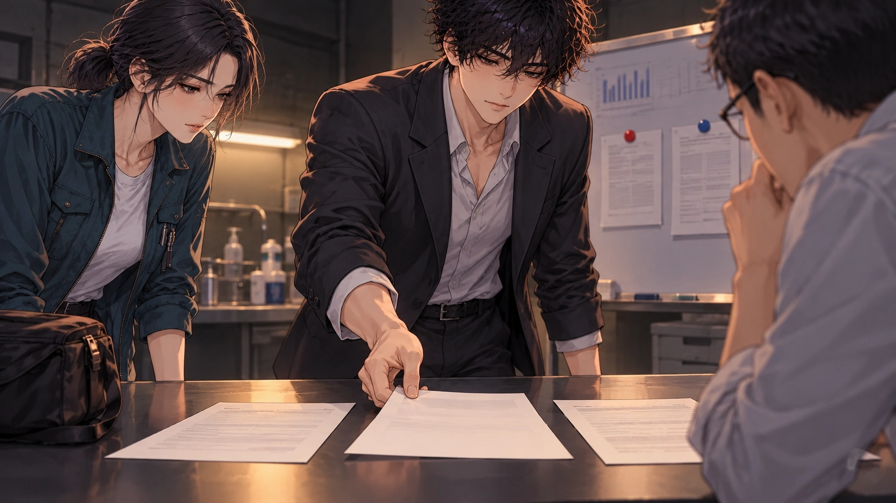 |
| 73 | 현주가 맨발로 거실을 가로질러 와 식탁 위 태블릿의 전원 버튼을 길게 눌렀다. | CHANGES / 미연결 | 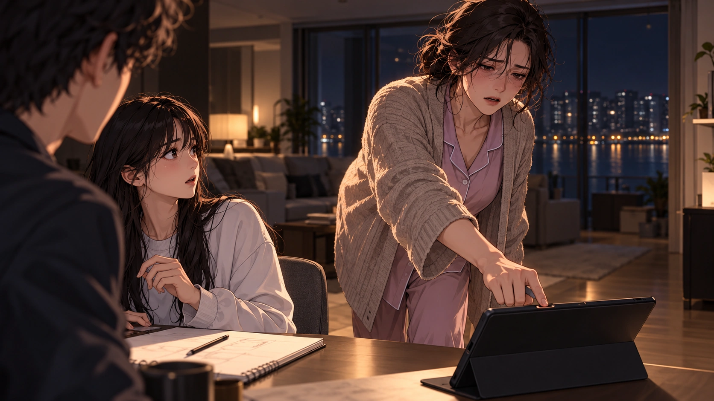 |
| 74 | 민석이 작업복 주머니에서 휴대폰을 꺼내 화면을 켰다. | CHANGES / 미연결 |  |
| 75 | 다섯 사람이 차례로 앞으로 나와 전자 서명 패드에 자기 이름을 적었다. 아까처럼 흔쾌한 서명이 아니었다. 자기 구역 예산을 직접 깎아 내고 올리는 무거운 서명이었다. | CHANGES / 미연결 | 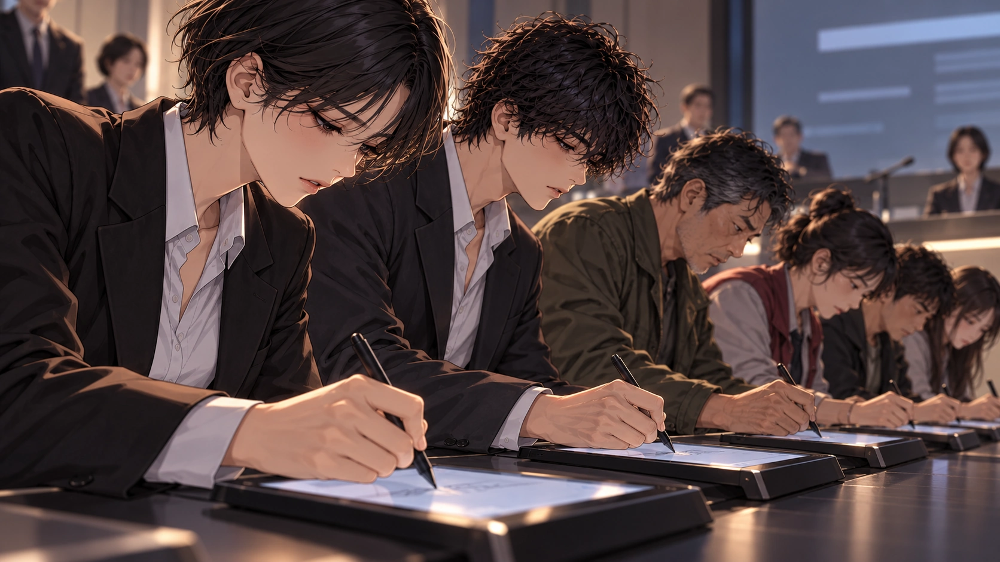 |
| 76 | 건어물 집 여자는 덮이려던 장부 모서리를 손바닥으로 가만히 눌렀다. 맨 아래 7번 줄에 적힌 자기 가게 호수를 내려다보더니, 계산대 위의 볼펜을 직접 집어 들었다. | PASS / 미연결 | 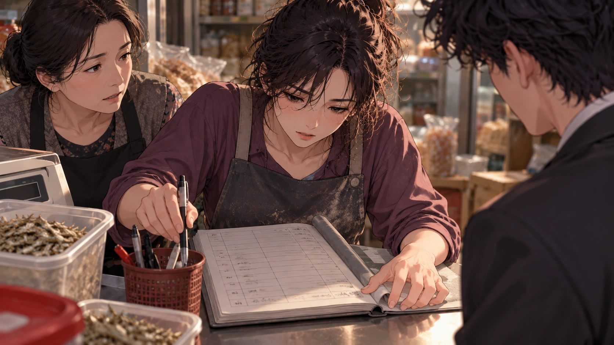 |
| 77 | 마흔 중반 여자도 자리에서 일어나 코르크판 앞으로 다가갔다. 돋보기를 꺼내 쓰고 '좌측 손 미세운동 저하' 줄을 읽더니, 들고 있던 볼펜을 탁자 위에 도로 내려놓았다. | PASS / 미연결 | 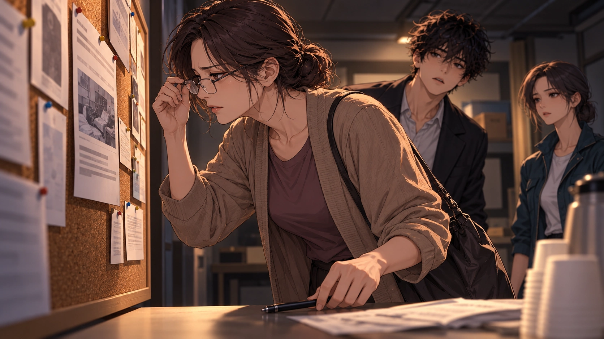 |
| 78 | 서인이 도면 위로 손을 뻗어 전류 차단기 부품을 옆으로 밀었다. | CHANGES / 미연결 | 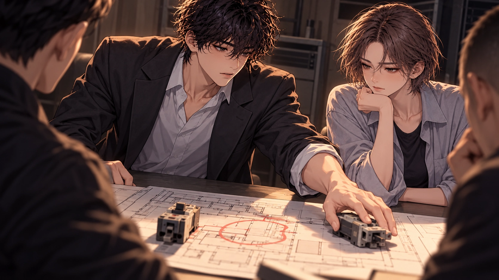 |
| 79 | 서인은 휴대폰 메모장에 오랫동안 저장만 해 두었던 문서를 열어 김 영감 앞에 내밀었다. | CHANGES / 미연결 | 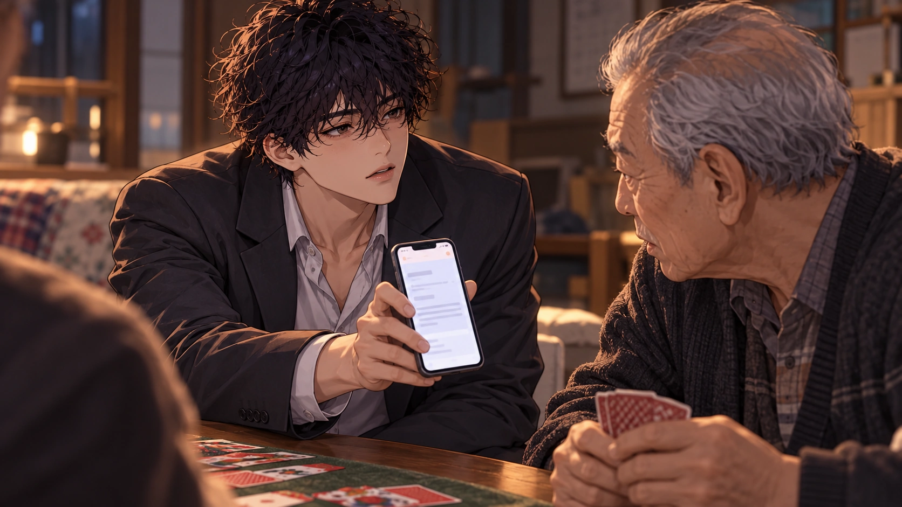 |
| 80 | 서인은 자리에서 일어나 신발장 위의 차폐 상자 뚜껑을 열었다. 여자의 단말 하나만 꺼내 건넸다. | PASS / 미연결 | 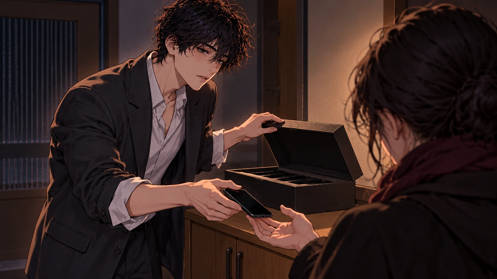 |
| 81 | 여자가 볼펜 끝으로 그 줄을 두 번 그었다가 멈췄다. | CHANGES / 미연결 | 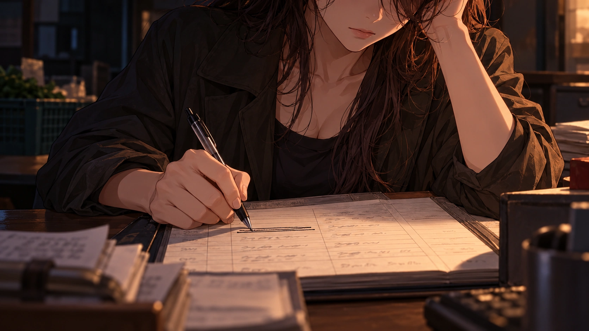 |
| 82 | 쉰쯤 된 남자가 볼펜을 탁자 위에 도로 내려놓았다. | CHANGES / 미연결 | 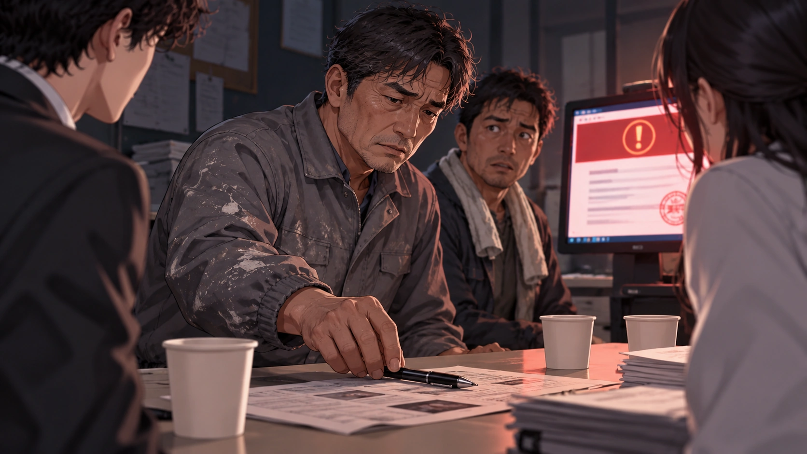 |
| 83 | 할머니가 식탁 위의 메모지를 끌어당겨 볼펜으로 자기 기준자 고유 번호 여섯 자리와 서명을 눌러 적어 서인에게 밀었다. | CHANGES / 미연결 | 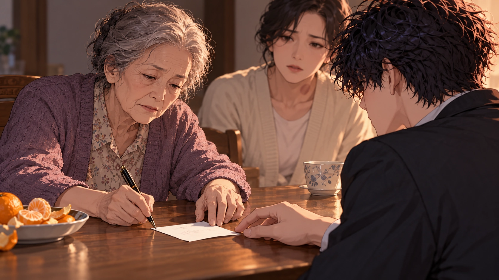 |
| 84 | 서인은 주머니에서 어제 저녁 9층 할머니가 적어 준 여섯 자리 고유 번호 메모지를 꺼내 신청서 옆에 놓았다. | CHANGES / 미연결 | 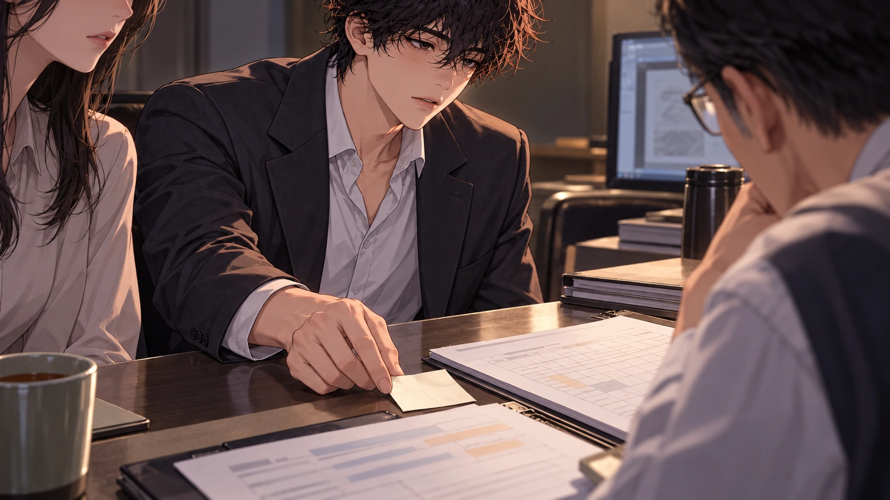 |
| 85 | 하경이 굳은 얼굴로 신청서 철을 펼쳐 내밀었다. | PASS / 미연결 |  |
| 86 | 서인은 맞은편 의자에 앉았다. 여자가 장부를 펼쳤다. 야간 대타 예비비와 약품 지원비가 같은 페이지에 있었다. | PASS / 미연결 / 보류 |  |
| 87 | 서인은 엽서에서 손을 뗐다. 메모할 종이에 신청서와 등록 사본의 쪽수를 같이 적었다. 문해경은 그가 적은 두 쪽을 확인한 뒤에야 부엌으로 갔다. | CHANGES / 미연결 / 보류 |  |
| 88 | 다은은 가방에서 자기 종이를 꺼냈다. 같은 질문지 뒷면에 볼펜으로 여러 줄을 적어 왔다. | CHANGES / 미연결 / 보류 |  |
| 89 | 서인은 가져온 메모를 꺼냈다. 기간 연장 아래는 비어 있었다. 담당자가 옆 책상의 연결선을 뽑는 동안 서인은 문서들을 한꺼번에 저장 목록에 넣었다. | PASS / 미연결 / 보류 |  |
| 90 | 서인은 봉지에서 빵을 꺼내 둘로 갈랐다. 크림이 손가락에 묻어 접수 종이로 떨어지려 했다. 도윤이 봉지의 빈 쪽을 펼쳐 받쳤다. | PASS / 미연결 / 보류 |  |
| 91 | 서인은 빈칸 앞에 얼마를 적었다가 펜을 놓았다. 우석이 그 종이를 가져갔다. | PASS / 미연결 |  |
| 92 | 서인이 그 종이를 집었다. 배당을 받으며 야간 연결을 쉬었던 사람들의 첫해 기록이었다. | PASS / 미연결 |  |
| 93 | 서인이 고개를 끄덕이자 여자는 볼펜 뚜껑을 닫았다. 딸은 그 소리가 나고서야 문 옆의 벽에서 등을 뗐다. | CHANGES / 미연결 |  |
| 94 | 서인이 종이를 돌려줬다. 우석은 취소할 연락처 대신 약속 장소를 열었다. | CHANGES / 미연결 |  |
| 95 | 우석이 자기 휴대폰을 집어 들고 일어났다. 서인은 그를 붙들지 않고 빈 의자를 발로 밀어 줬다. 통화가 끝날 때까지 도윤도 자료를 넘기지 않았다. | CHANGES / 미연결 |  |
| 96 | 서인이 말했다. 손님이 종이를 뒤집었다. 뒷면에는 이어지는 결과가 없었다. | PASS / 미연결 |  |
| 97 | 다은은 연습지를 휴대폰 위에 엎어 덮었다. 서인이 더 적으려고 든 펜 끝이 종이 뒤에 닿았다. 그는 그 펜을 내려놓았다. | CHANGES / 미연결 |  |
| 98 | 여자의 외투에서 짧은 진동이 울렸다. 그녀가 휴대폰을 서인에게 건넸다. | CHANGES / 미연결 |  |
| 99 | 서인이 말했다. 그는 옛 문서를 먼저 접었다. 우석은 서인의 글로 돌아와 첫 장부터 다시 읽었다. | PASS / 미연결 |  |
| 100 | 도윤은 서인의 펜을 집었다가 탁자에 내려놓았다. | PASS / 미연결 |  |
| 101 | 우석이 자기 휴대폰을 꺼냈다. 인지해방 쪽에서 일하는 이소현과 생활 상담을 다니는 최나경에게 오늘 글을 읽을 시간이 있는지 물었다. TOKEN 쪽 남자에게도 연락했다. 각자 답이 온 뒤 서인에게 이름을 보여 줬다. | CHANGES / 미연결 |  |
| 102 | 남자는 휴대폰을 가져가려다가 화면을 서인 쪽으로 다시 돌렸다. 소현이 공유할 참석자 이름과 안내문을 올린 곳이었다. 서인이 허락한 네 사람에 오늘 글을 함께 읽겠다는 두 사람이 더 있었다. 서인은 이름과 안내문을 확인한 뒤 그 범위에는 보내도 좋다고 답했다. | PASS / 미연결 |  |
| 103 | 서인은 일어나 상자를 들고 왔다. 자기 문서 위에 놓지 않고 빈자리에 받쳤다. 윤 여사가 달걀 봉지를 옮기려다 손잡이 찢어진 장바구니를 다시 쳐다봤다. | CHANGES / 미연결 |  |
| 104 | 서인은 남자의 휴대폰을 돌려주지 못했다. 남자가 손을 내밀었다. 그제야 탁자에 내려놓았다. | PASS / 미연결 |  |
| 105 | 그는 제목을 이번에 받은 의견으로 고쳤다. 화면을 돌려 두 사람이 읽게 했다. 도윤은 장부실 안쪽에서 우석이 들고 온 종이를 함께 보고 있었다. TOKEN 쪽 남자는 오늘 참석하지 않아 자기 의견을 따로 보내 왔다. 서인은 그 답도 다른 사람의 말과 합치지 않았다. | PASS / 미연결 |  |
